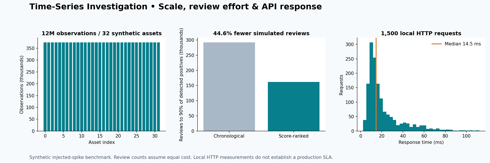
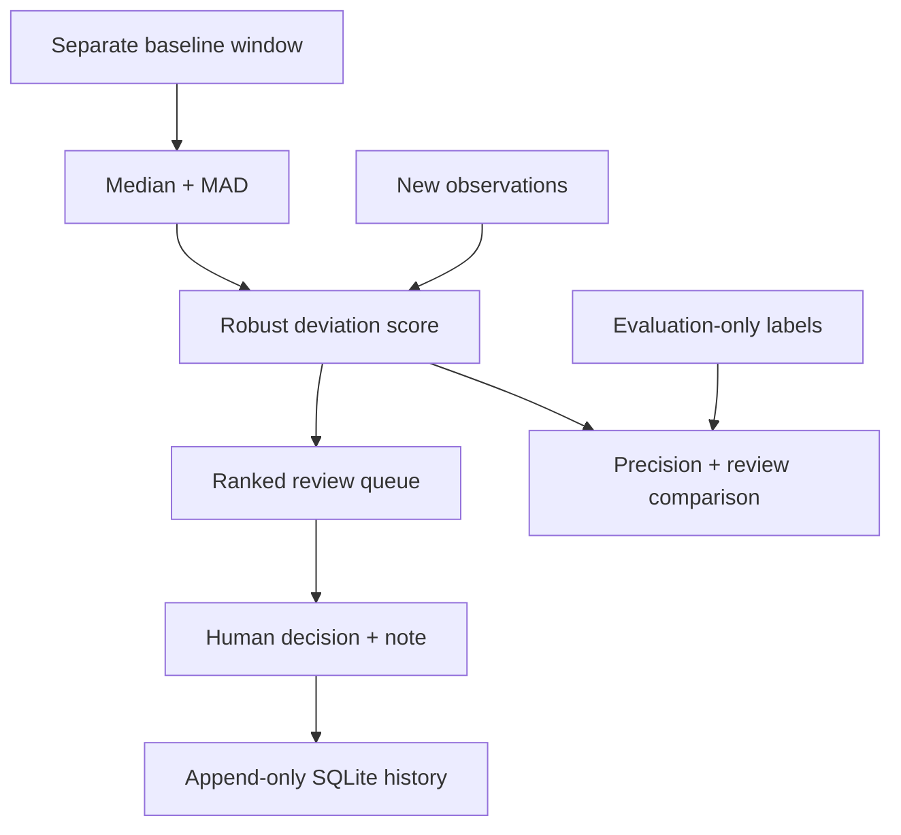
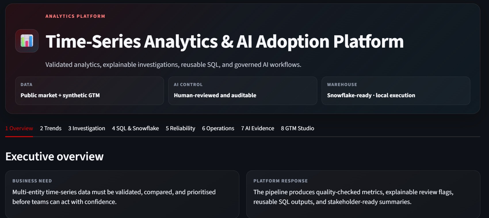

# Time-Series Investigation Platform

[](https://github.com/reginoldraj7777-code/financial-market-analytics-platform/actions/workflows/api.yml) · [Documentation](docs/README.md) · [Verified CI run](docs/ci_verification.md)

### Detect unusual behavior. Explain the flag. Preserve the review decision.

A Python analytics portfolio with a deterministic **12-million-observation** benchmark, an explainable FastAPI scoring service, an append-only human review log, and an existing Streamlit analytics dashboard. Public and synthetic inputs only.

[Run locally](#run-locally) · [API guide](docs/api_guide.md) · [Claim-to-code map](docs/resume_evidence.md) · [Methodology](docs/evaluation_methodology.md)



## Executed evidence

| Capability | Measured result | Evidence |
|---|---:|---|
| Multi-asset scale | **12,000,000 observations / 32 synthetic assets** | [Manifest](evidence/full/metrics.json), [per-asset counts](evidence/full/entity_results.csv) |
| Detection recall | **96.03%** of injected anomalies | [Benchmark implementation](src/investigation.py) |
| Highest alert-decile precision | **100%** on 32,489 alerts | Easy synthetic spikes; not independent production accuracy |
| Review prioritization | **44.63%** fewer reviews to the same detected-positive recall | 292,285 chronological vs 161,837 ranked |
| Critical-module test coverage | **96.34%** combined statement + branch coverage | [Coverage report](evidence/full/coverage.json) |
| Local HTTP service | **14.55 ms median**, 100.0% correct responses | [1,500 request records](evidence/full/http_requests.csv), [environment](evidence/full/http_metrics.json) |

These metrics come from the committed synthetic benchmark and local HTTP run. They do not establish historical 87% precision, 60% analyst-time savings, or a 99.5% production SLA. The original four-stock dashboard remains a separate, smaller demonstration.

## Run locally

Python 3.12:

```bash
python -m venv .venv
source .venv/bin/activate
pip install -r requirements-dev.txt
python -m pytest -q --cov=src.api --cov=src.investigation --cov-branch --cov-fail-under=90
python -m src.investigation --full --output evidence/reproduced
EVIDENCE_DIR=evidence/reproduced uvicorn src.api:app --host 127.0.0.1 --port 8000
```

Open `http://127.0.0.1:8000/docs` for interactive API documentation. In a second terminal, run `python scripts/load_test.py --output evidence/reproduced`. The committed `evidence/full` queue also works without regenerating 12M observations.

```bash
# Original offline dashboard
python src/main.py --offline
python src/preflight.py
streamlit run app.py

# Container (Docker required)
docker build -t investigation-api .
docker run --rm -p 127.0.0.1:8000:8000 investigation-api
```

## Investigation flow



`POST /score` accepts finite values and a baseline. `GET /alerts` returns an explainable queue without ground-truth labels. `POST /reviews` records confirmed, dismissed or needs-context decisions; `GET /reviews` preserves the history. The API is a trusted local demo: add authentication, authorization, retention controls and operational monitoring before exposing it publicly.

## Existing dashboard



The original workflow covers public market data, synthetic operations and GTM diagnostics, SQL outputs and stakeholder interpretation. [Open the dashboard guide](docs/dashboard_guide.md). Snowflake live mode remains optional and credential-gated. No company, customer or confidential data is used.

## Reproduction and deployment boundaries

The [workflow](.github/workflows/api.yml) defines full-scale evaluation, a 90% critical-module coverage gate, Docker build and HTTP smoke/load checks. The [published CI run](docs/ci_verification.md) passed the full benchmark, coverage gate, Docker build and container HTTP checks on 23 October 2026. This verifies a containerized demo, not a live cloud deployment. Review data is local SQLite; mount persistent storage if needed. [Verification record](evidence/full/verification.md) lists actual checks and [AI assistance record](docs/ai_assistance_log.json) documents implementation provenance.

## Repository guide

| Location | Contents |
|---|---|
| `app.py and src/` | Dashboard, analytics pipeline and scoring API |
| `scripts/` | Evaluation utilities and Windows launchers |
| `sql/` | Optional Snowflake schema and analysis |
| `outputs/` | Committed dashboard snapshot |
| `evidence/full/` | Separate benchmark and HTTP records |
| `docs/` | Current guides, demo material and historical records |
