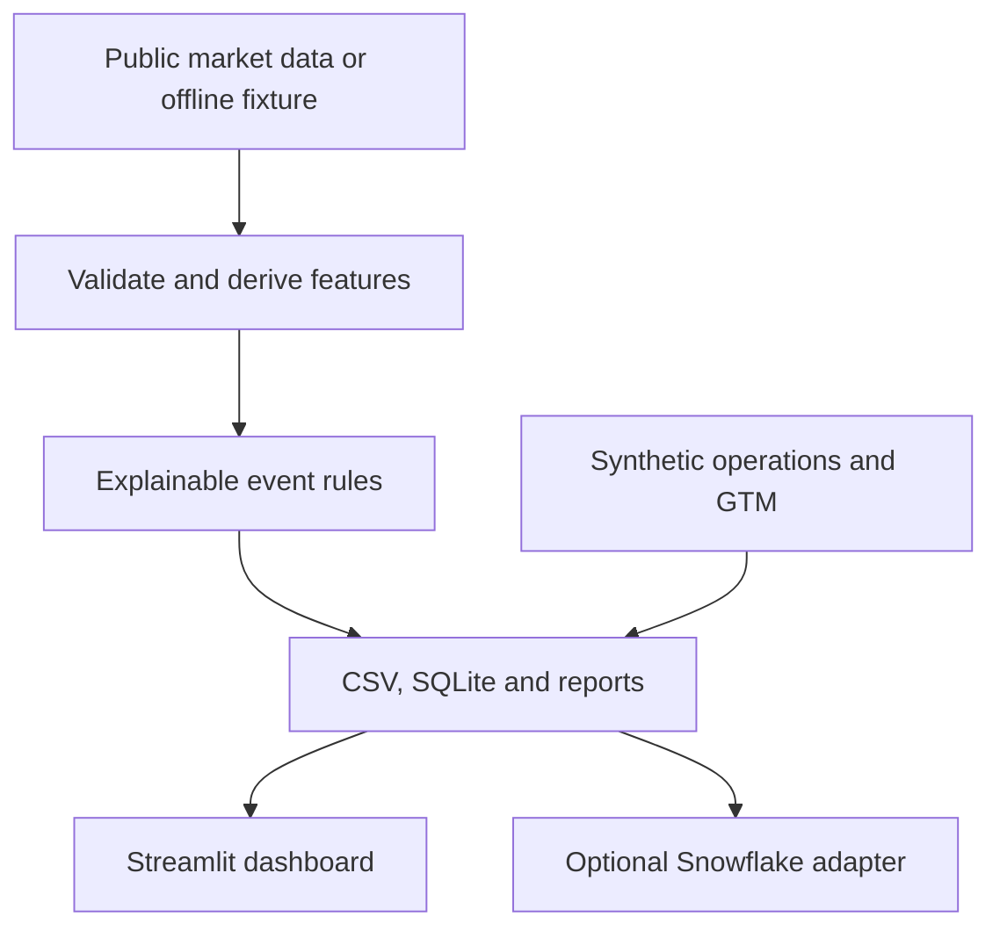

# Architecture

The repository contains two independent workflows. The dashboard processes public-market or deterministic offline records; the API benchmark evaluates a separate synthetic anomaly fixture. Their measurements are not interchangeable.

## Dashboard workflow

`src/main.py` owns ingestion and output generation. `src/dashboard_utils.py` defines analytical helpers; `src/gtm_demo.py` provides synthetic GTM data. `app.py` reads the prepared outputs. Snowflake operations remain credential-dependent and gated in `src/snowflake_adapter.py`.

## Scoring and review API

`src/investigation.py` builds a separate median/MAD baseline and evaluates 12M synthetic observations. `src/api.py` serves scores and a label-free review queue, then appends human decisions to SQLite. The benchmark's injected labels are used only for evaluation. See the [API guide](api_guide.md) and [evaluation protocol](evaluation_methodology.md).

## Storage and operational boundaries

| Location | Role |
|---|---|
| `outputs/` | Committed dashboard snapshot; regenerated by the offline pipeline |
| `evidence/full/` | Recorded synthetic benchmark and local HTTP evidence |
| `evidence/reproduced/` | Ignored local reruns |
| `data/reviews.db` | Ignored local review history; mount persistent storage for container use |
| `docs/ai_assistance_log.json` | Development provenance displayed by the dashboard |

The API is a trusted local demo without authentication. Passing CI confirms the repository's tests, container build and HTTP checks; it does not establish a live deployment, long-term SLA or analyst-time savings.
